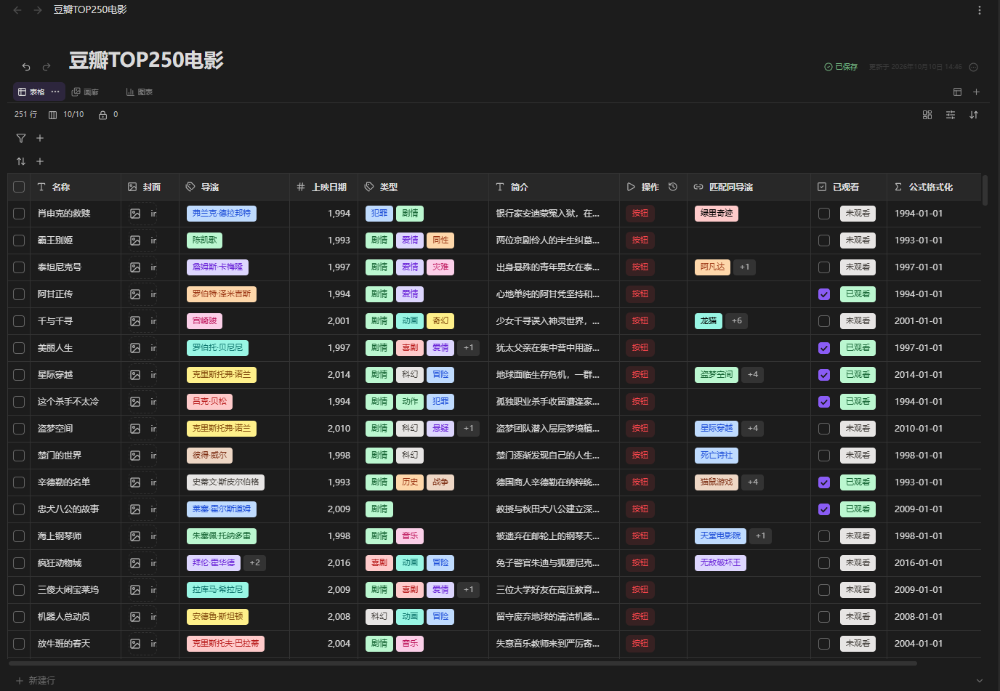
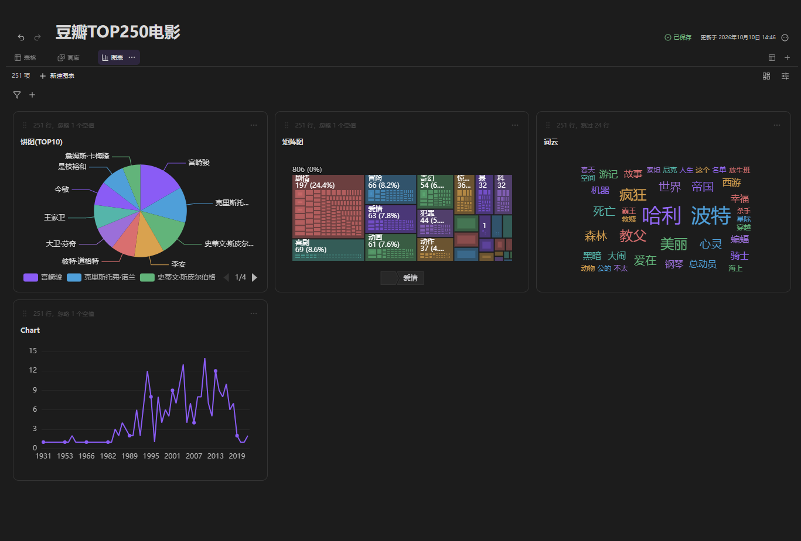
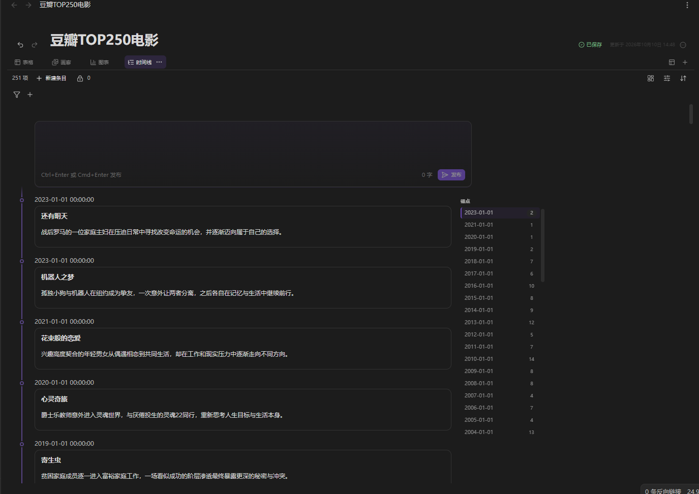
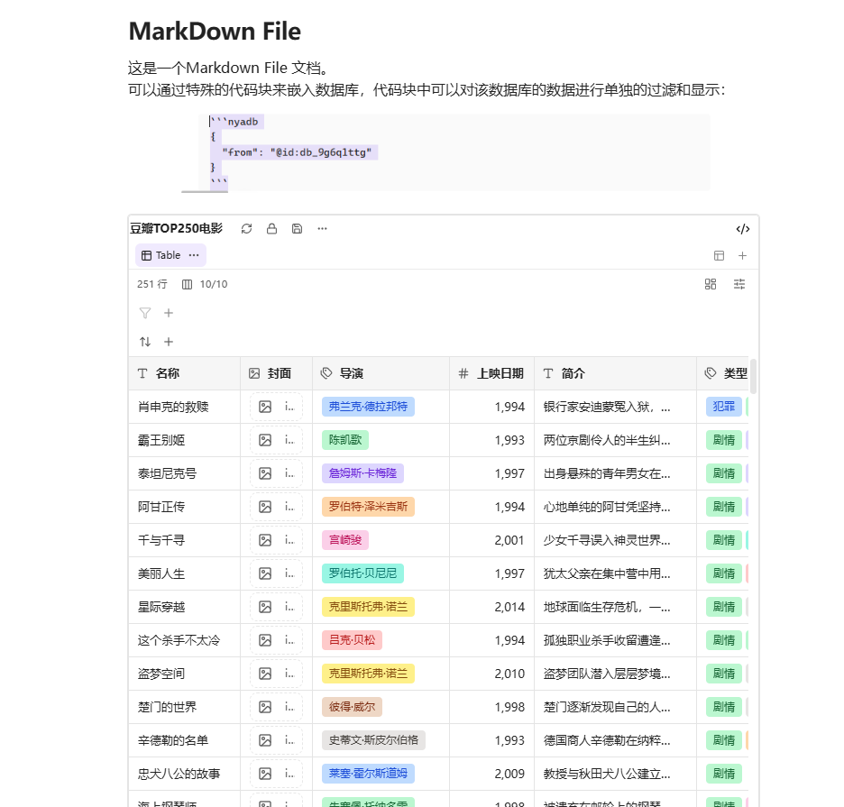

# Obsidian Nya Database

[中文](./README.zh-CN.md)  
[English](./README.md)

A database plugin for Obsidian. It stores structured JSON in custom `.nyason` files and takes over displaying, editing, querying, and saving.

## Views

Supports seven saved view types: Table, Gallery, Timeline, Calendar, Chat, Grouped Board, and Charts.







## Supported Column Types

- `text`: plain text
- `number`: numeric
- `checkbox`: boolean
- `date`: date
- `datetime`: date and time
- `select`: single-select option
- `multiselect`: multi-select options
- `link`: link
- `image`: image
- `formula`: runtime-derived column that does not persist its own cell value
- `action`: button-behavior column that does not persist its own cell value and can run scripts
- `reference`: reference column that matches records in this or another database by conditions; results are derived at runtime and not stored in row values

Every column has a required, schema-unique `code`, used as the stable reference for Markdown `nyadb`, XLSX/TSV/JSON exchange, the Plugin API, and Formula.

## Markdown `nyadb` Queries

- `nyadb` uses JSON structured queries. A database can be referenced by `@id:`, `@path:`, or its exact name, and columns are referenced by `code`.
- Supports all seven layouts, locally saved view settings, Refresh, Save, filtering, and layout switching, read-only by default.
- With `editMode` explicitly enabled, limited writeback is available for cells, detail fields, options, and source rows.

Minimal query:

```json
{
  "from": "@path:Tasks.nyason"
}
```

## Installation & Compatibility

- Requires Obsidian `1.11.4` or newer; desktop and mobile are supported.
- Manual install: put `main.js`, `manifest.json`, and `styles.css` into `.obsidian/plugins/obsidian-nya-database/` in your vault, then enable the plugin in Obsidian.

## API Usage

The plugin exposes an internal Obsidian JavaScript API (version `0.3`) through `plugin.api`. It is disabled by default; row writes, field configuration, view writes, and metadata changes use separate permissions, with an optional Obsidian secret storage token.

```js
const api = app.plugins.plugins['obsidian-nya-database'].api.createAPI({
  token: 'Your API Token',
});
```

When no secret storage ID is configured, the token may be omitted:

```js
const api = app.plugins.plugins['obsidian-nya-database'].api.createAPI();
```
